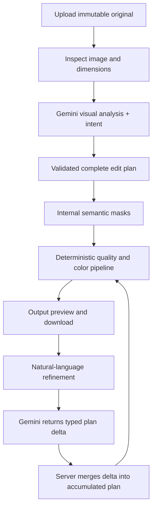

# Architecture

## One orchestration pipeline

There is one product engine: `runAutoEdit`. It coordinates Gemini analysis, plan validation, deterministic rendering, and output QA. Internal algorithms are implementation stages, not separate user-facing workflows.

## Responsibilities

- UI: upload, progress, result, original comparison, natural-language refinement, download.
- API route: input limits, MIME validation, server-only Gemini credentials, the official `@google/genai` SDK (Gemini Developer API), bounded timeout, provider error mapping, initial-plan/delta validation, and cumulative plan merge.
- Observability: structured Vercel runtime events carry a request ID and processing stage; provider errors are classified and sanitized. Image bytes, prompts, and credentials are never logged.
- Edit plan schema: bounded numeric parameters, image-quality operations, and normalized region coordinates.
- Refinement service: applies only fields returned in a validated delta; unchanged global settings, quality settings, region contours, and regional adjustments remain intact.
- Rendering pipeline: renders the cumulative plan from immutable original pixels; it never uses the previous compressed output as its source.
- Cinematic knowledge: searchable, versioned metadata and mathematically described looks; retrieval informs the plan but never executes arbitrary code.

## Trust boundaries

Treat image metadata, user prompts, Gemini output, catalog records, and uploaded bytes as untrusted. Validate MIME, byte limits, JSON schema, numeric bounds, region count, and coordinates. Keep GEMINI_API_KEY server-only. Never pass model output to eval, dynamic imports, shader source compilation, shell, or SQL.

## Refinement semantics

The first request returns a complete plan. Every subsequent request receives the accumulated plan and must return a delta:
- global and quality objects contain only changed fields, expressed as new absolute values;
- region updates target existing regions by their stable label and only contain changed fields;
- new regions and removals are explicit operations;
- omitted values are preserved by deterministic merge logic.

The merged plan becomes the new source of truth. Rendering from the original prevents cumulative raster compression, blur, and rounding artifacts while retaining all prior user-requested changes.

## Determinism and reproducibility

A result is determined by source-image hash, accumulated edit-plan version, engine version, and color-management configuration. Persist these values with each revision when persistence is introduced. Each refinement is reconstructed from the immutable original plus the accumulated plan.

## Image quality pipeline

1. Decode and inspect dimensions; reject sources above the configured pixel limit.
2. Upscale sources whose long edge is below 1920 pixels using browser Canvas high-quality image smoothing, preserving aspect ratio and without cropping.
3. Apply an edge-aware, tiled denoise pass only when requested by the image analysis.
4. Apply global and regional tonal/color transforms in linear-light sRGB.
5. Apply tiled unsharp-mask passes for local clarity and edge acutance.
6. Apply a restrained radial vignette only when the plan requests it.
7. Export a PNG for comparison and download.

Upscaling is interpolation, not super-resolution. It cannot recover missing focus, texture, or sensor detail. The deterministic sharpening stage increases perceived acutance but does not synthesize real high-frequency information.

## Mask strategy

The current pipeline requests Gemini contour segmentation: each region carries a normalized bounding box and polygon mask, validated against coordinate bounds, then rasterized and feathered internally before local transforms. The contour is model-generated and may still be imperfect; QA and a fallback strategy remain necessary. Mask creation and editing remain invisible to the user.

## Execution strategy

- Processing is client-side in Canvas 2D, with tiled temporary buffers for denoise/detail passes.
- Small images are upscaled to a 1920px long edge; larger images retain their native dimensions.
- Never allocate unbounded pixel buffers; current source limit remains 24 megapixels.
- Add request rate limiting, authentication/abuse controls, and durable job processing before public production use. Structured server logs are already implemented with sensitive payload redaction.
