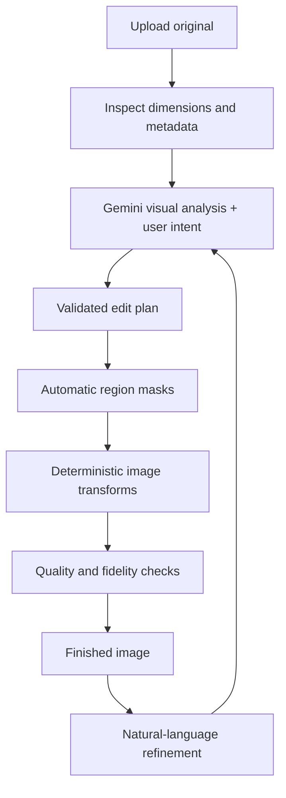

# Architecture

## One orchestration pipeline

There is one product engine: `runAutoEdit` as the conceptual orchestration boundary. It coordinates analysis, plan validation, mask construction, deterministic rendering, and output QA. Internal algorithms are private implementation stages, not separately exposed engines or user workflows.

## Responsibilities

- UI: upload, progress, result, original comparison, natural-language refinement, download.
- API route: input limits, MIME validation, server-only Gemini credentials, timeout, provider error mapping, output validation.
- Edit plan schema: bounded numeric parameters and normalized region coordinates.
- Rendering pipeline: replay plan from original pixels; no model access and no network dependency.
- Cinematic knowledge: searchable, versioned metadata and mathematically described looks; retrieval informs the plan but never executes arbitrary code.

## Trust boundaries

Treat image metadata, user prompts, Gemini output, catalog records, and uploaded bytes as untrusted. Validate MIME, byte limits, JSON schema, numeric bounds, region count, and coordinates. Keep GEMINI_API_KEY server-only. Never pass model output to eval, dynamic imports, shader source compilation, shell, or SQL.

## Determinism and reproducibility

A result is determined by source-image hash, edit-plan version, engine version, and color-management configuration. Persist these values with each revision when persistence is introduced. Each refinement starts from the immutable original rather than the previous raster output.

## Mask strategy

The bootstrap uses conservative normalized bounding boxes with feathered edges as a temporary mask representation. This is explicitly approximate. Production segmentation should generate alpha masks from a dedicated segmentation model or validated image-processing method. Mask creation and editing remain invisible to the user.

## Execution strategy

- Small images: browser worker/GPU path.
- Large images: bounded server-side processing or chunked WebAssembly.
- Never allocate unbounded pixel buffers.
- Add request rate limiting, authentication/abuse controls, observability redaction, and durable job processing before public production use.
